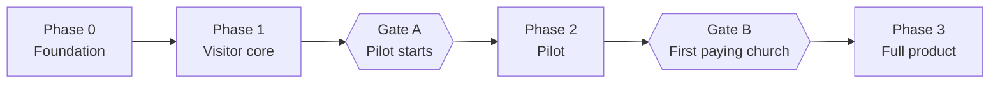

Owner: Ryan · Status: draft · Last reviewed: 2026-11-24

# Roadmap

We pass a gate when its condition is met, not when a date arrives. This roadmap has no dates because none has been agreed.

The phases come from the conditions the founder board set for Limen: a backend, real login and LGPD end to end before any real data; launch with the visitor core only; 5 to 10 pilot churches, with targets set in advance. Each phase is a GitHub milestone, and the [project board](https://github.com/orgs/marco-zero-labs/projects/2) holds the live status.

Where we are: Phase 0.

## Phases

| Phase | Goal | Owner | Epics |
| --- | --- | --- | --- |
| 0 Foundation | House docs, CI and branches; the backend chosen; the data model on the server with tenant isolation; real login; the server repository; public routes writing to the server | Caio, Ryan, Issac | #1, #2, #3 |
| 1 Visitor core | A pilot build with only the visitor core: funnel on the server, WhatsApp handoff, member import, reminders and LGPD end to end | Ryan, Issac, Caio | #23, #24, #25 |
| 2 Pilot | 5 to 10 churches, the success criteria measured per church, a weekly review | Issac, Ryan | #43, #44, #45 |
| 3 Full product | Schedules, attendance and calendar back on the server; store builds; the plan for large churches | Ryan, Caio | #51 to #55 |
| Backlog | The product's own visual identity, i18n, the monthly docs review | Ryan | #56, #57, #58 |

## Gates

The gates follow the levels of the Marco Zero Labs product template. Each move to a new level is recorded in an ADR.

| Gate | Level | Condition |
| --- | --- | --- |
| A · Pilot starts | 2, pilot | Nothing real enters the system before these are done: privacy and security docs, terms and consent text reviewed by a lawyer, the pilot success criteria written, the pilot churches chosen, a usability test with fictional data and the Marco Zero Labs endorsement on the entry screen (#35 to #42) |
| B · First paying church | 3, paid | Operations docs and runbooks, a payment provider with recurring billing, a DPA template for churches and the price validated with the pilot (#46 to #50) |

The pilot targets (contacts on time, visitors moving through the funnel, leaders still recording after 30 days) are set before the pilot, in #38. Until then they are `[to decide]`.
